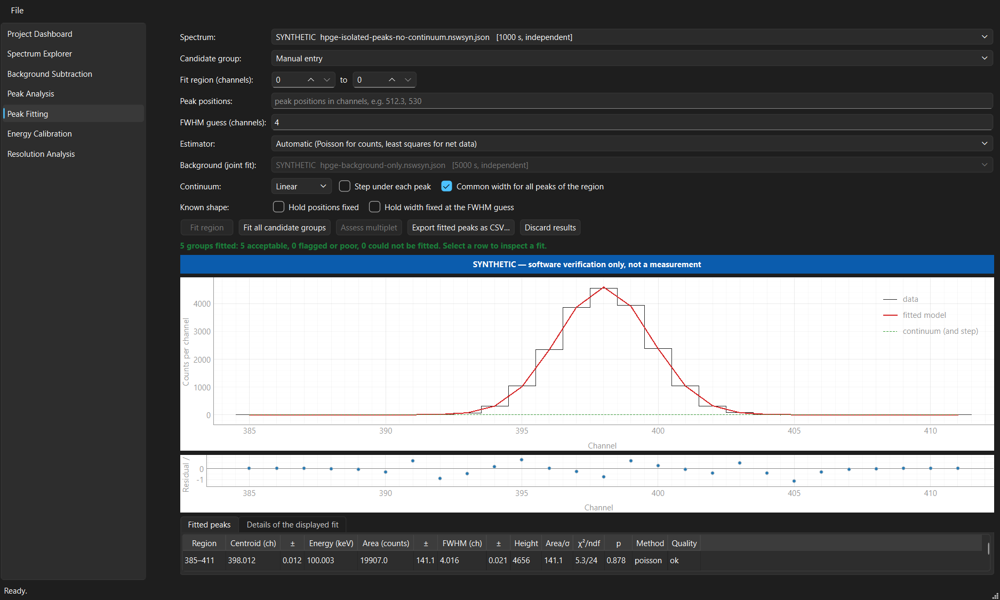
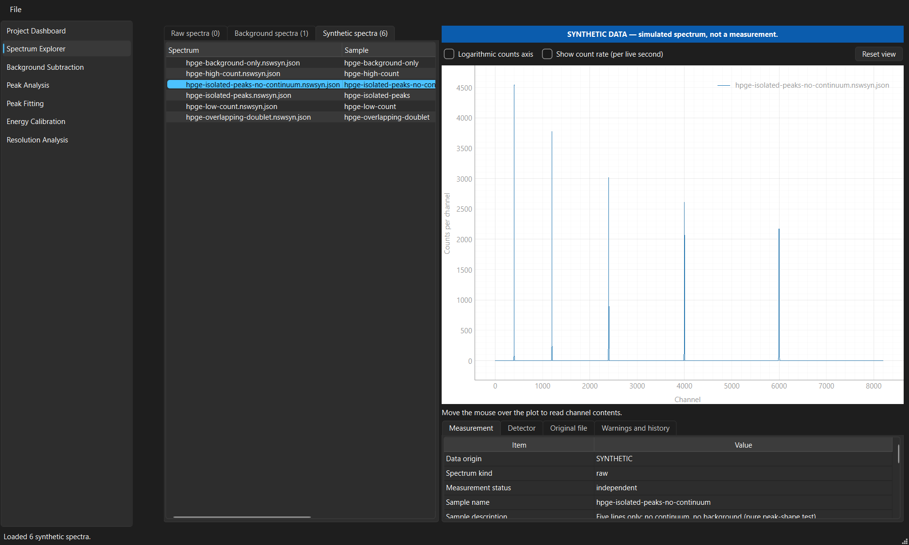
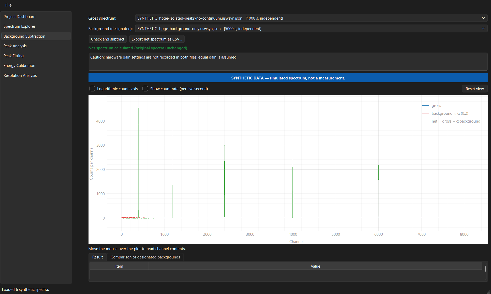
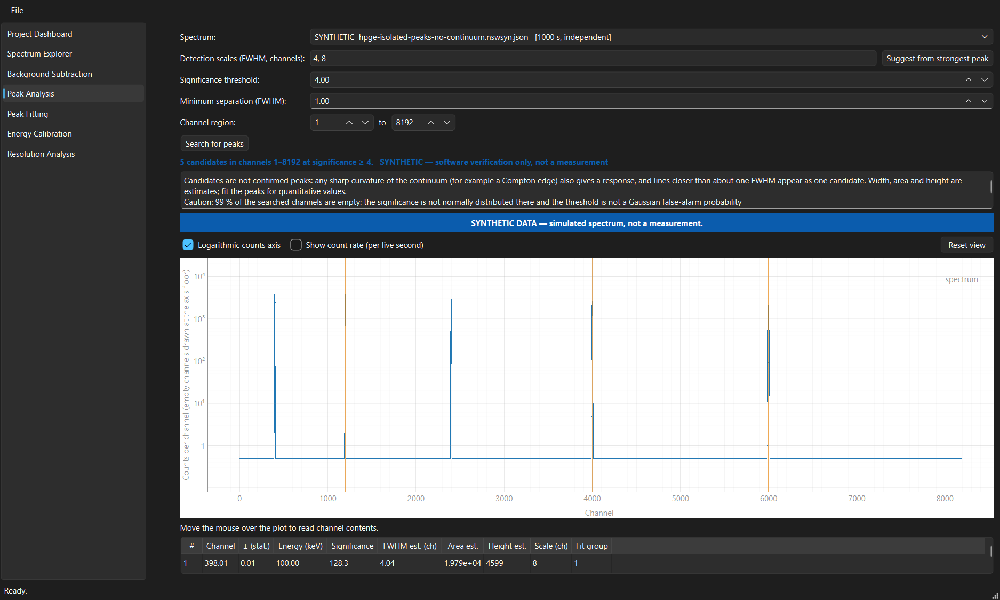
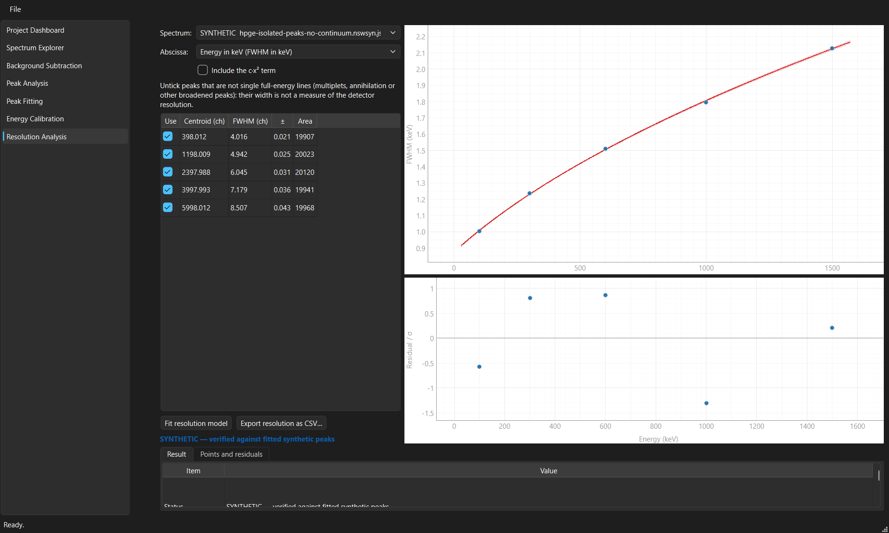

# Nuclear Spectroscopy Workbench (NSW)

NSW is a Windows desktop application and Python library for analysing gamma-ray
spectra from HPGe and NaI(Tl) detectors.

**Status: beta candidate (`0.9.0.dev0`; last release `v0.1.0-alpha`).**
The calculation engines are tested against synthetic spectra with known ground truth. Nothing in this repository is an
experimentally validated measurement result; see
[Scientific limitations](#scientific-limitations).



*All screenshots show simulated spectra produced by NSW's own generator.*

## Purpose

A gamma spectrum becomes a result (which nuclides, how much activity) only through a
chain of steps: reading the instrument file, subtracting a background, finding and
fitting peaks, calibrating energy, resolution and efficiency, and propagating the
uncertainty of each step. Mistakes in that chain are usually silent: a wrong
calibration stored in a file, a background that is not a background, an uncertainty
that ignores a correlation.

NSW aims to make that chain explicit and checkable:

- every number carries its uncertainty and the method that produced it;
- every spectrum carries its origin (measured or synthetic) and the SHA-256 of its data;
- a calculation whose inputs are missing is refused with the list of what is missing,
  instead of returning a number;
- each engine is tested against independent references and simulated data with known
  truth.

## Features

| Feature | Calculation engine (tested) | Desktop page |
|---|---|---|
| Spectrum import: Canberra/Mirion Lynx CSV, Lynx XML (`.ava`), CAM (`.cnf`), chosen by file content | yes (on fabricated files in these formats) | yes: Project Dashboard |
| Measurement identity (duplicate exports, intermediate saves of one acquisition), SHA-256 integrity manifests | yes | yes: Project Dashboard |
| Detector profiles for HPGe and NaI(Tl), kept separate | yes | shown in the Spectrum Explorer |
| Interactive spectrum viewer (overlay, log axis, count rate, metadata, export) | – | yes: Spectrum Explorer |
| Mouse-driven analysis: navigate / zoom-box / region / select modes, regions of interest drawn and edited on the plot, undo/redo, context menu, shortcuts | yes (`nsw.services.roi`) | yes: Spectrum Explorer → Regions of interest |
| Automatic peak search when a spectrum is opened; candidates classed strong / weak / doubtful / not photopeak-like; exclude and restore | yes | yes: Regions of interest |
| Region fitting, residuals, nested continuum-model comparison | yes | yes: Regions of interest |
| Decision threshold, detection limit and coverage interval: ISO 11929 framework or Currie, selectable; from counts or from the peak fit | yes (Monte Carlo validated; ISO conformity not claimed) | yes: Regions of interest |
| Optional HPGe low-energy tail (Gaussian + exponential tail), bootstrap-calibrated model test | yes, partly validated; informational | yes: Advanced mode |
| Background subtraction with live-time scaling and compatibility checks | yes | yes: Background Subtraction |
| Peak detection (second-derivative filter, significance, several scales) | yes | yes: Peak Analysis |
| Peak fitting (Poisson likelihood, least squares, joint gross + background; covariance, goodness of fit, multiplet evidence) | yes | yes: Peak Fitting |
| Energy calibration (effective-variance regression, order test, valid range, position stability); suggested line assignments from a library and an approximate gain; duplicate, coverage and outlier checks | yes | yes: Energy Calibration |
| Detector resolution model FWHM² = a + bx + cx² | yes | yes: Resolution Analysis |
| Decay correction, full-energy-peak efficiency curve, activity | yes, on synthetic sources only | yes: Efficiency Calibration, Activity Calculation (refused for experimental spectra, with the list of missing inputs) |
| Nuclide candidates ranked against a reference library | yes, with a fictitious test library only | yes: Nuclide Identification (candidates with evidence, never an identification) |
| Nuclear Data Explorer: libraries with full provenance, evaluation differences, reference lines on spectra with a verified calibration, peak-to-line matching with accept / reject | yes | yes: Nuclear Data Explorer |
| Guided workflow (twelve stages with status and reasons), Beginner and Advanced modes | yes (`nsw.services.workflow`) | yes: panel under the page list |
| Synthetic spectrum generator with stored ground truth (HPGe-like and NaI-like) | yes | generated files can be opened |
| Project file (SQLite, append-only history, fits reproduced on reopening, analyst decisions and regions saved, result digests verified, file names only) | yes | yes: Project File |
| PDF analysis reports; SVG, PDF or PNG figures | yes | File menu |
| Consolidated synthetic validation with pass criteria and repeatability | yes (`scripts/run_validation.py`) | — |
| Windows installer (per user, no administrator rights) with licences and synthetic demo spectra; executable self-test | yes (`packaging/windows/`, `scripts/build_windows.ps1`) | — |

A "calculation engine" is a tested module that can be called from Python. A "desktop
page" is reachable in the application; the twelve pages are exercised by automated
interface tests (including synthesised mouse and keyboard input) and the self-test, not
yet by a recorded manual walk-through ([docs/reports/UX_TEST_REPORT.md](docs/reports/UX_TEST_REPORT.md)).

## Screenshots

| Spectrum Explorer | Background subtraction |
|---|---|
|  |  |

| Peak search | Resolution analysis |
|---|---|
|  |  |

## Technology

| Used | For |
|---|---|
| Python 3.12 or later (calculation engine also 3.11) | language |
| NumPy, SciPy | numerics, statistics |
| Pydantic | validated records (calibrations, settings, nuclear-data model) |
| PyYAML | settings file |
| PySide6 (Qt for Python), PyQtGraph | desktop interface, interactive plots |
| SQLite (Python standard library) | project files |
| Matplotlib | PDF reports and figures |
| PyInstaller, Inno Setup | Windows executable and installer |
| uv (`uv.lock`) | locked, reproducible environments |
| pytest, pytest-qt, Hypothesis, pytest-cov, Ruff (incl. security rules), MyPy (strict), pip-audit | tests, lint, static types, dependency audit |

## Architecture

```
ui  ->  services  ->  analysis / simulation / io / detectors  ->  core
```

| Package | Role |
|---|---|
| `nsw.core` | immutable `Spectrum`, units and quantities, calibration records, nuclear-data model |
| `nsw.io` | file readers, measurement identity, integrity manifests, reference-data files |
| `nsw.detectors` | HPGe and NaI(Tl) profiles |
| `nsw.analysis` | background, peak search, fitting, energy calibration, resolution, decay, efficiency, activity, identification |
| `nsw.simulation` | spectrum generator, fictitious sources and library |
| `nsw.services` | use cases called by the interface; gates for experimental data |
| `nsw.ui` | pages; long calculations run on worker threads |

A test inspects the imports: the scientific packages never import Qt or configuration,
and the interface calls `services` only. Details:
[docs/design/architecture.md](docs/design/architecture.md),
[TECHNICAL_DECISIONS.md](TECHNICAL_DECISIONS.md).

## Installation

**Windows installer:** download `NSW-Setup-<version>-x64.exe` and `SHA256SUMS.txt`
from the release page; see [docs/user/WINDOWS_INSTALLER.md](docs/user/WINDOWS_INSTALLER.md)
(the installer is not code-signed).

**From source (Windows, PowerShell)** requires Python 3.12 or later for the desktop interface (the calculation engine
also runs on 3.11; PySide6 6.12 aborts Python 3.11 with a `none_dealloc` error) and
[uv](https://docs.astral.sh/uv/).

```powershell
git clone <repository-url>
cd Nuclear-Spectroscopy-Workbench
uv sync --locked --all-extras
.venv\Scripts\python.exe -m pytest
```

Without `uv`: `py -3.12 -m venv .venv`, then
`.venv\Scripts\python.exe -m pip install -e ".[gui,dev]"`.

## Usage

Create example spectra and start the application:

```powershell
.venv\Scripts\python.exe scripts\generate_synthetic.py
.venv\Scripts\python.exe -m nsw.ui.app
```

1. **Import.** *File → Open synthetic dataset folder…* and choose `data\synthetic\hpge`.
   For your own Lynx files use *Open experimental dataset folder…*; the folder is only
   read. The dashboard reports what was imported and what NSW noticed about the files.
2. **Inspect.** *Spectrum Explorer*: select a spectrum to plot it, several to overlay
   them; the tabs show metadata, detector settings, file hashes and warnings. Peak
   candidates are found and marked automatically. Press **R** and drag to mark a region,
   **F** to fit it; the *Regions of interest* tab shows net counts, fit, residuals and
   detection limits (ISO 11929 or Currie). The workflow panel suggests the next step.
3. **Background subtraction.** Designate a measurement as background (right-click in
   the explorer; synthetic background spectra are offered directly), then on
   *Background Subtraction* choose gross spectrum and background and press
   *Check and subtract*.
4. **Detect peaks.** *Peak Analysis*: choose the spectrum and the expected peak widths,
   then *Search for peaks*.
5. **Fit peaks.** *Peak Fitting*: *Fit all candidate groups*, or enter a region and
   positions and press *Fit region*. Each fit shows residuals, uncertainties and a
   quality verdict.
6. **Calibrate energy.** *Energy Calibration*: enter a reference energy and its source
   for fitted peaks, then *Fit calibration*. Calibrations of measured spectra are
   stored as provisional; spectra stay in channel units until a calibration is verified.
7. **Resolution.** *Resolution Analysis*: *Fit resolution model* to the fitted widths.
8. **Efficiency and activity.** Open `data\synthetic\sources`, fit the peaks of
   `syn-cal-source` and `syn-x-sample`, then use *Efficiency Calibration* and *Activity
   Calculation* with the fictitious sources SYN-CAL and SYN-X.
9. **Nuclear data and candidates.** *Nuclear Data Explorer* shows library records with
   their provenance and draws reference lines on calibrated spectra; *Nuclide
   Identification* ranks library nuclides against the fitted peaks.
10. **Save and report.** *File → New project…*, *Save session to project*; *File → Export
    analysis report (PDF)…*.

`python -m nsw.ui.app --self-test FOLDER` (or `NSW.exe --self-test FOLDER`) runs the whole
workflow on generated spectra and writes `FOLDER\selftest.log`.

Full guide: [docs/user/user_manual.md](docs/user/user_manual.md).

As a library:

```python
from nsw.io import read_spectrum
from nsw.analysis.peaks import PeakSearchSettings, find_peak_candidates
from nsw.analysis.fitting import fit_candidates

spectrum = read_spectrum("data/synthetic/hpge/hpge-isolated-peaks.nswsyn.json")
search = find_peak_candidates(spectrum, PeakSearchSettings(fwhm_channels=(4.0, 8.0)))
for outcome in fit_candidates(spectrum, search):
    if outcome.result is not None and outcome.result.ok:
        for peak in outcome.result.peaks:
            print(f"{peak.centroid:.2f} ± {peak.centroid_unc:.2f} ch, {peak.area:.0f} counts")
```

## Testing and validation

Run of 2026-11-12 in this repository (Windows 11, CPython 3.12, environment from `uv.lock`):

| Check | Result |
|---|---|
| `pytest` | 558 passed, 0 failed (318 unit, 63 integration, 177 validation) |
| Coverage of non-GUI code | 92 % (unit and validation tests without the slow Monte Carlo runs) |
| `ruff check`, `ruff format --check` | clean |
| `mypy --strict` on `src/nsw` | clean |

- **Software verification:** results compared with hand calculations, analytical limits,
  finite differences and independent numerical solutions.
- **Synthetic validation:** bias, coverage of stated uncertainties, false-detection rate
  and detection probability from Monte Carlo ensembles of generated spectra;
  `scripts/validate_peak_fitting.py` reproduces the tables.
- **Experimental validation: none.** During development the software was also run on
  private laboratory HPGe measurements as a check of file handling. Those measurements
  and the tests that read them are not part of this repository, and no physical
  reference value has been reproduced.

An independent review of the efficiency, activity and nuclide-candidate code found
and led to the correction of fifteen defects; what remains open is listed in
[docs/reports/REVIEW_PHASE8_9.md](docs/reports/REVIEW_PHASE8_9.md).

Numbers and methods: [VALIDATION_REPORT.md](VALIDATION_REPORT.md),
[docs/science/scientific_methodology.md](docs/science/scientific_methodology.md).

## Scientific limitations

- **Energy calibration of measured spectra is provisional.** A calibration embedded in
  an instrument file is untrusted, and a fitted calibration of measured data is stored
  as unverified until the line assignments and a traceable source of reference
  energies are confirmed. Such spectra are shown in channel units.
- **Gain drift is not modelled.** A calibration has no validity period in time; one
  calibration cannot be assumed to serve every acquisition.
- **The low-energy tail model is optional and informational.** Strong HPGe peaks fitted
  with the Gaussian model are reported as poor fits; the tail model is validated only
  on part of the planned grid and its fits are not stored in projects.
- Weak peaks fitted with free position and width are biased high. Decision thresholds
  and detection limits follow the ISO 11929 framework or Currie; conformity with the
  standard has not been verified against its text or an independent implementation.
- **Experimental efficiency and activity are blocked.** They need certified source
  activities with reference dates, the source-detector geometry and the detector
  model. Without them the engines refuse measured spectra.
- True coincidence summing and self-attenuation are not corrected.
- **No experimental NaI(Tl) validation.** NaI(Tl) support is tested on simulations only.
- **Nuclear-data integration is pending.** NSW ships no decay data; the identification
  engine is tested with an explicitly fictitious library. Real data (DDEP, ENSDF) must
  be imported by the user with their provenance ([docs/science/nuclear_data.md](docs/science/nuclear_data.md)).
- The installer passes its automated install / self-test / uninstall check on the
  development PC; a test on a clean machine (no Python) is pending, and it is not
  code-signed.

## Roadmap

| Milestone | State |
|---|---|
| Data model, importers, identity and integrity | done |
| Spectrum viewer, background subtraction | done |
| Peak search and fitting, energy calibration, resolution | done (engine and page) |
| Efficiency, activity, nuclide candidates | done (engines and pages; synthetic data only) |
| Validation runner, project database, reports | done |
| Interactive analysis (regions, automatic search, model comparison, Nuclear Data Explorer, assisted calibration, workflow, modes) | done; manual walk-through pending |
| Detection limits (ISO 11929 framework / Currie), HPGe tail model | implemented; independent comparison and full tail validation pending |
| Windows installer | built and smoke-tested; clean-machine test pending |
| External benchmark datasets | surveyed (`docs/science/external_dataset_discovery.md`); none adopted yet |

Details: [docs/design/ROADMAP.md](docs/design/ROADMAP.md), [docs/design/POST_V1_ROADMAP.md](docs/design/POST_V1_ROADMAP.md). Changes: [CHANGELOG.md](CHANGELOG.md).

## Documentation

- [docs/README.md](docs/README.md) (index)
- [docs/graph/](docs/graph/) — interactive map of the code (HTML, opens in a browser)
- [docs/user/user_manual.md](docs/user/user_manual.md), [docs/user/installation.md](docs/user/installation.md),
  [docs/user/WINDOWS_INSTALLER.md](docs/user/WINDOWS_INSTALLER.md)
- [docs/design/architecture.md](docs/design/architecture.md), [docs/user/file_formats.md](docs/user/file_formats.md)
- [docs/science/scientific_methodology.md](docs/science/scientific_methodology.md),
  [VALIDATION_REPORT.md](VALIDATION_REPORT.md)
- [docs/science/nuclear_data.md](docs/science/nuclear_data.md), [DATA_LICENSES.md](DATA_LICENSES.md),
  [THIRD_PARTY_NOTICES.md](THIRD_PARTY_NOTICES.md)
- [TECHNICAL_DECISIONS.md](TECHNICAL_DECISIONS.md), [CONTRIBUTING.md](CONTRIBUTING.md),
  [SECURITY.md](SECURITY.md)

## Licence

The original NSW source code and documentation are released under the
[MIT License](LICENSE), copyright (c) 2026 Aravind Loshana A. The licence covers that
original material only, not third-party packages
([THIRD_PARTY_NOTICES.md](THIRD_PARTY_NOTICES.md)), laboratory measurements or nuclear
data ([DATA_LICENSES.md](DATA_LICENSES.md)).

## Acknowledgement

Developed by Aravind Loshana A with AI assistance (Claude Code). Design decisions, test
evidence and limitations are recorded in the documents above.
